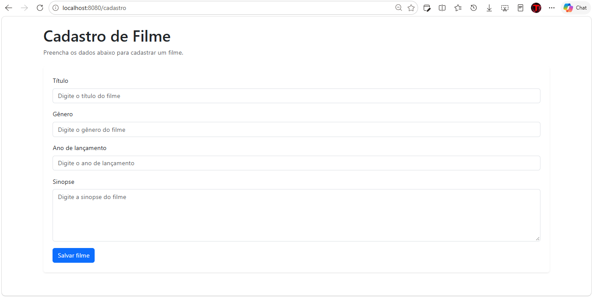
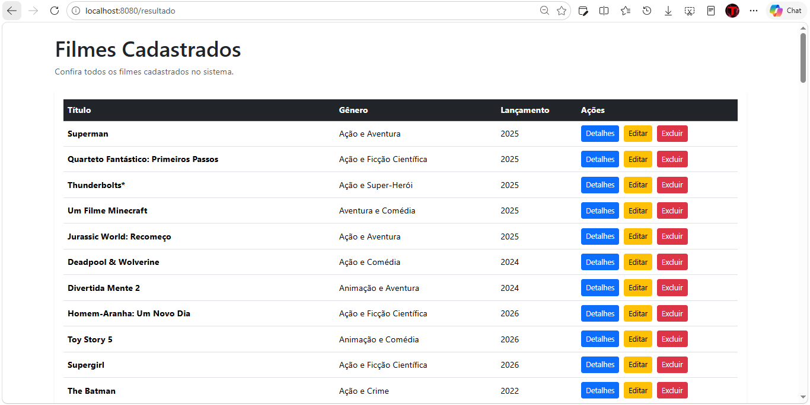
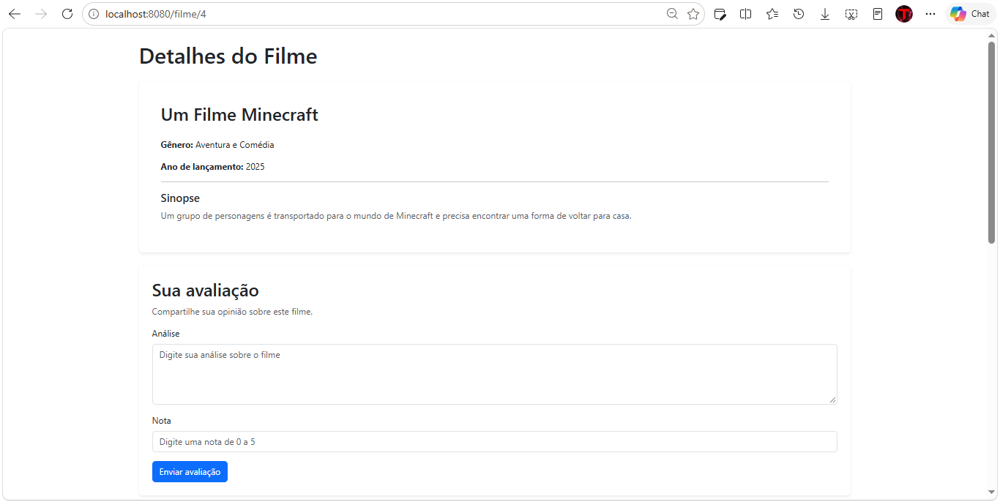
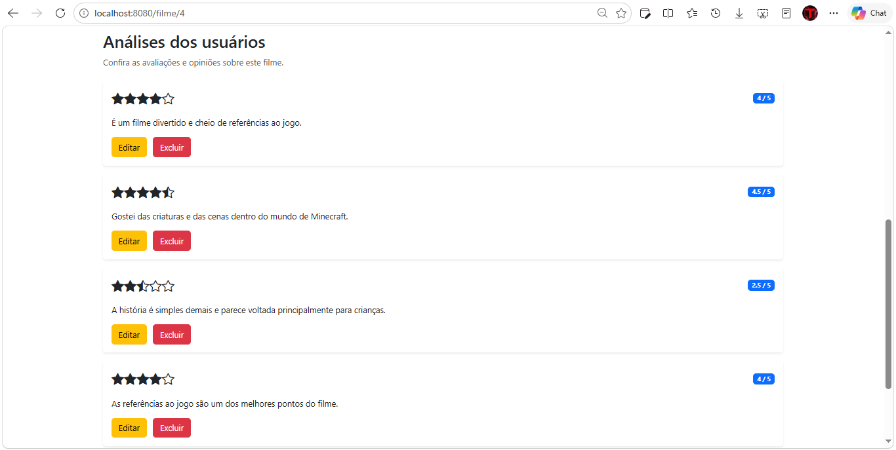

# CineReview

Projeto web desenvolvido como prática de desenvolvimento de sistemas com Java e Spring Boot.

O sistema permite cadastrar filmes, consultar os filmes cadastrados, visualizar os detalhes de cada filme e trabalhar com análises e notas. A aplicação utiliza uma API REST no back-end e JavaScript com jQuery e AJAX no front-end para realizar as requisições.

## Funcionalidades

- Cadastro de filmes
- Listagem de filmes cadastrados
- Visualização dos detalhes de um filme
- Edição de filmes
- Exclusão de filmes
- Cadastro de análises
- Edição de análises
- Exclusão de análises
- Registro de notas de 0 a 5
- Exibição das notas por estrelas
- Consumo da API REST pelo front-end usando AJAX

## Tecnologias utilizadas

- Java 17
- Spring Boot
- Spring MVC
- Spring Data JPA
- Hibernate
- MySQL
- Thymeleaf
- JavaScript
- jQuery
- Bootstrap
- Bootstrap Icons

## Estrutura do projeto

```text
CineReview/
├── src/
├── banco/
│   └── cinema.sql
├── screenshot/
│   ├── cadastro.png
│   ├── filmes.png
│   ├── detalhes.png
│   └── analises.png
├── pom.xml
├── README.md
└── .gitignore
```

## Banco de dados

O projeto possui um script SQL dentro da pasta `banco`.

O arquivo `cinema.sql`:

- cria o banco de dados `cinema`;
- cria as tabelas `filme` e `analise`;
- configura o relacionamento entre filmes e análises;
- insere 100 filmes para teste;
- insere análises de exemplo relacionadas aos filmes;
- permite recriar as tabelas do zero para facilitar a configuração do projeto.

Para utilizar o banco:

1. Abra o MySQL Workbench ou outro cliente MySQL.
2. Execute o arquivo `banco/cinema.sql`.
3. Verifique as credenciais de acesso ao MySQL na configuração da aplicação.
4. Execute o projeto pelo NetBeans ou pela IDE de sua preferência.

## Screenshots

### Cadastro de filme



### Filmes cadastrados



### Detalhes do filme



### Análises



## API REST

O projeto também possui uma API REST responsável pelas operações de filmes e análises.

Entre as operações utilizadas pela aplicação estão:

- `GET` para consultar filmes e análises;
- `POST` para cadastrar novos registros;
- `PUT` para editar registros;
- `DELETE` para remover registros.

O front-end realiza essas operações utilizando AJAX, permitindo que as páginas consumam diretamente os recursos disponibilizados pela API.

## Objetivo do projeto

Este projeto foi desenvolvido para colocar em prática conceitos de desenvolvimento web com Java e Spring, principalmente a integração entre uma API REST, banco de dados e uma interface web.

Além da parte de back-end, o projeto também serviu para praticar JavaScript, jQuery, AJAX e a comunicação entre front-end e back-end.

## Próximos passos

Algumas funcionalidades que podem ser adicionadas futuramente:

- autenticação e login de usuários;
- cadastro de usuários;
- associação das análises ao usuário que as criou;
- recuperação de senha por e-mail;
- validações adicionais;
- melhorias na interface;
- filtros e pesquisa de filmes.

---

## Autor

**Matheus Silva Melo**

Estudante de Desenvolvimento de Sistemas, com foco em desenvolvimento web utilizando Java e Spring Boot.
